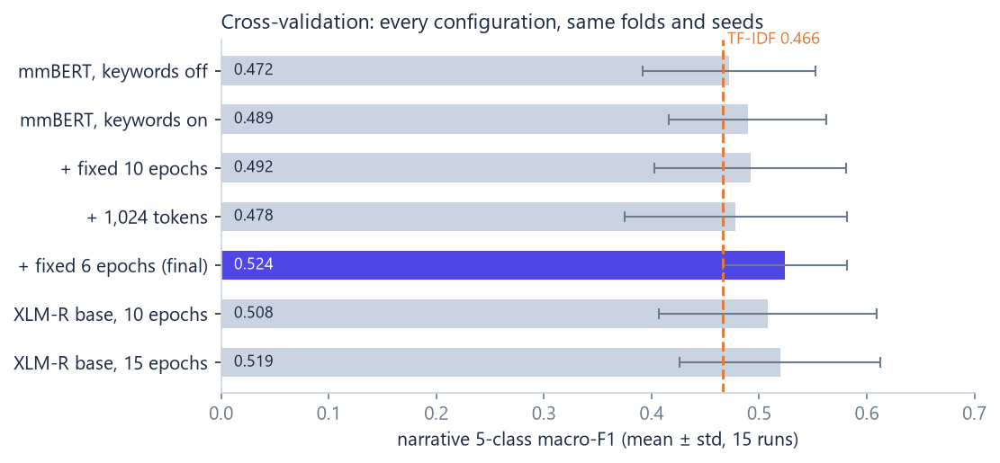
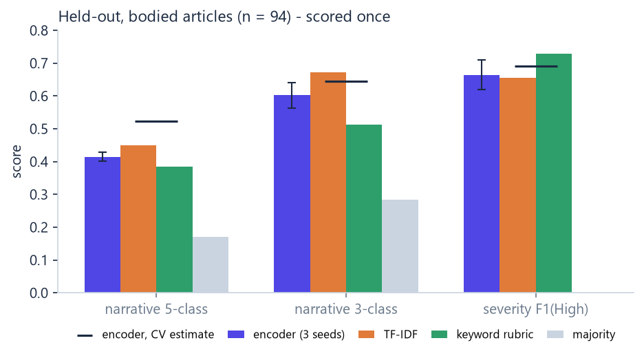
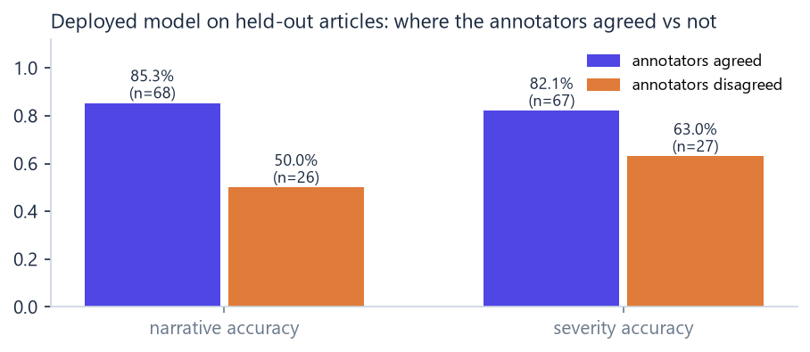

# OSINT Shield — technical report

**Classifying defence & security news with a fine-tuned multilingual encoder, and running it live.**
November 2026 · code: this repository · decisions log: [DECISIONS.md](DECISIONS.md) (D1–D25) ·
day-by-day log: [PROGRESS.md](PROGRESS.md)

---

## Summary

- **Task.** Label defence and security news articles with a **narrative** (Security, Political,
  Civilian, Investigation, Other), a **severity** (High / Low) and **propaganda** (yes / no), from
  1,064 articles labelled by two LLM annotators (Claude, Llama).
- **Headline result.** A fine-tuned `mmBERT-small` (42 M parameters in the encoder body), scored once on 94
  held-out articles, reaches narrative macro-F1 **0.415 ± 0.014**, 3-class **0.602 ± 0.039**,
  severity F1(High) **0.664 ± 0.045** — **statistically indistinguishable from TF-IDF + logistic
  regression** (every paired 95% bootstrap interval includes zero). Its cross-validation lead
  (+0.057) did not survive contact with unseen data.
- **Why.** Label quality is the ceiling, not the model: the two annotators agreed on 74.3% of
  narratives, and the model is **85.3%** accurate where they agreed versus **50.0%** where they did
  not. 56% of its errors fall on the 28% of articles the annotators disagreed on.
- **What else was measured, not assumed.** Truncating at 512 tokens costs nothing measurable;
  keyword fusion helps a little, mainly on the rare Investigation class; headline-only articles are
  barely classifiable and the model is *over*-confident on them; propaganda (7 labelled positives)
  cannot be learned and is reported as *not reliably assessed*.
- **Live system.** RSS + Google News collection every 15 minutes, a relevance filter, article-text
  extraction, the classifier, and Llama 3.2 3B writing summaries whose quotes are **checked word for
  word** (37 invented quotes caught in the first hour), behind a FastAPI service and a React
  dashboard — all on one 6 GB laptop GPU.
- **Biggest open problems.** Label adjudication; what "High severity" means (in this corpus it
  often means *militarily significant topic*, not *incident now*); and article text for Google
  News items, which an undocumented Google endpoint provides only until it rate-limits.

---

## 1 · Data

| fact | value | consequence |
|---|---|---|
| articles | 1,064 | small: every estimate needs its uncertainty |
| narrative classes | Security 824 (77.4%) · Political 155 · Civilian 41 · Other 26 · Investigation 18 · Radicalization 0 | macro-F1, not accuracy; Radicalization dropped (D6) |
| severity | High 241 (22.7%) · Low 823 | F1 on the High class |
| propaganda | 7 positives | diagnostic only (D3) |
| no body text | 490 (46%), all Google News | the main data-quality issue |
| body ⇄ severity confound | High: 34.0% of bodied vs 9.5% of headline-only | a classifier fed *only* "has a body?" scores F1(High) 0.467 |
| annotator agreement | narrative 74.3% · severity 79.9% | a ceiling on any honest score |
| duplicates | 11 exact; 22 near-duplicate clusters, 12 spanning the original splits | group-aware folds (D5) |
| length | bodied median 3,618 chars; 74.8% of inputs truncated at 512 tokens | tested in D14 |
| language | English 1,032 · Hindi 29 · Kannada 3 | multilingual claims are untestable |

**Evaluation protocol** ([D1](DECISIONS.md), [D2](DECISIONS.md), [D5](DECISIONS.md)). The
original `test.csv` (159 articles) was locked away on day one and scored **once**, at the end.
Development used 5-fold cross-validation over the remaining articles that have a body (476),
with near-duplicates grouped so no story sits in both training and test, propaganda positives
stratified, and 3 seeds per fold (15 runs per configuration). Training uses bodied articles only
(`body_only`): including headline-only rows would let the model learn the body ⇄ severity
shortcut. Details: [DATA_REPORT.md](DATA_REPORT.md).

---

## 2 · Model

```
headline <eos> body ──► mmBERT-small encoder (frozen word embeddings, SDPA attention)
   (512 tokens)                │ mean pooling
                               ▼
     11 rubric keyword-group counts (whole article, log1p, standardised) ──► concat
                               ├──► narrative head  (5 classes)
                               ├──► severity head   (2 classes)
                               └──► propaganda head (2 classes, loss weight 0.3, pos. weight ≤ 10×)
```

| setting | value | why |
|---|---|---|
| encoder | `jhu-clsp/mmBERT-small`, **mean pooling** | its own config's pooling; `[CLS]` pooling cost 0.14 macro-F1 (D11) |
| memory | frozen word embeddings + SDPA attention | 4.73 → 2.63 GB, fits a display-sharing 6 GB GPU (D9) |
| keyword fusion | rubric group counts over the full text | user directive (D4); small measured gain (D12) |
| schedule | fixed 6 epochs, AdamW 2e-5, warmup 10%, linear decay | early stopping on ~47 rows was noise (D11, D13) |
| batch | 8 × accumulation 2, bf16 autocast | |
| chosen by | a rule fixed **before** the deciding run (D15) | |

Code: [`models/`](../src/osint_shield/models), [`training/`](../src/osint_shield/training),
configs [`base.yaml`](../configs/base.yaml) → [`mmbert_small.yaml`](../configs/mmbert_small.yaml).

---

## 3 · Results

### 3.1 Baselines — the bar to clear

Cross-validation, bodied articles, mean ± std over 5 folds.

| method | narrative 5-class | narrative 3-class | severity F1(High) | propaganda F1 |
|---|---|---|---|---|
| majority class | 0.172 | 0.287 | 0.000 | 0.000 |
| keyword rubric (rules) | 0.443 ± 0.058 | 0.517 ± 0.060 | 0.667 ± 0.038 | **0.118** |
| keyword counts + logistic regression | 0.383 ± 0.033 | 0.474 ± 0.032 | 0.675 ± 0.039 | 0.063 |
| **TF-IDF + logistic regression** | **0.466 ± 0.015** | **0.604 ± 0.038** | **0.687 ± 0.072** | 0.000 |

Without duplicate grouping, TF-IDF's 3-class score reads 0.627 instead of 0.604 — leakage that
grouping removes. The hand-written rubric is a strong severity baseline and the only method with
any propaganda signal, because its propaganda terms were copied from the positives (D18, D20).

### 3.2 Model development — what each experiment decided

Same 5 folds × 3 seeds for every row; mean ± std over the 15 runs.

| configuration | narrative 5-class | narrative 3-class | severity F1(High) | train time |
|---|---|---|---|---|
| mmBERT, `[CLS]` pooling (M5 v1) | 0.330 | — | — | — |
| mmBERT, mean pooling, keywords off | 0.472 ± 0.080 | 0.616 ± 0.061 | 0.656 ± 0.047 | 28 min |
| mmBERT, mean pooling, keywords on | 0.489 ± 0.073 | 0.625 ± 0.049 | 0.666 ± 0.042 | 29 min |
| + fixed 10 epochs (no early stopping) | 0.492 ± 0.089 | 0.629 ± 0.053 | 0.677 ± 0.069 | 35 min |
| + 1,024 tokens | 0.478 ± 0.103 | 0.612 ± 0.064 | 0.688 ± 0.059 | 70 min |
| **+ fixed 6 epochs — final** | **0.524 ± 0.058** | **0.646 ± 0.038** | **0.692 ± 0.060** | 20 min |
| XLM-R base, 10 epochs | 0.508 ± 0.101 | 0.642 ± 0.055 | 0.678 ± 0.082 | 44 min |
| XLM-R base, 15 epochs | 0.519 ± 0.093 | 0.648 ± 0.055 | 0.656 ± 0.059 | 61 min |



What the paired comparisons (same fold, same seed) decided:

| question | answer | decision |
|---|---|---|
| Why was the first run *below* TF-IDF? | three defects: `[CLS]` pooling on a model built for mean pooling (2 of 3 layers see only a 128-token window), an early-stopping signal an all-"High" model could game, and selection on 47 rows | fixed; +0.14 from pooling alone (D11) |
| Do keywords help? | +0.017 ± 0.072, 10/15 runs; Investigation F1 0.329 vs 0.254 | keep, as "directionally positive, not established" (D12) |
| Early stopping or a fixed schedule? | a tie on score; the final all-data model has nothing to early-stop on | fixed (D13) |
| Is truncation at 512 tokens hurting? | 1,024 tokens: −0.014 ± 0.101, 6/15; twice the time | keep 512 — the tail carries no measurable signal (D14) |
| mmBERT-small or XLM-R base? | narrative tie (−0.004, 6/15); mmBERT wins severity in 12/15 runs, steadier, half the size | mmBERT-small (D15) |

The final recipe beat TF-IDF on narrative in 4 of 5 folds (+0.057). It was, however, the best of
~8 configurations scored on the same folds, so that lead was expected to shrink.

### 3.3 Held-out — the headline number

Scored once, 2 October 2026, on the 94 bodied articles of `test.csv` untouched since day one.
Encoder = mean ± std over 3 seeds; the deployed model is seed 42, fixed in advance.

| task | encoder | TF-IDF | keyword rubric | majority | CV estimate |
|---|---|---|---|---|---|
| narrative 5-class | **0.415 ± 0.014** | 0.449 | 0.385 | 0.171 | 0.524 |
| narrative 3-class | **0.602 ± 0.039** | 0.673 | 0.513 | 0.285 | 0.646 |
| severity F1(High) | **0.664 ± 0.045** | 0.656 | 0.730 | 0.000 | 0.692 |

Paired bootstrap (4,000 resamples), encoder − TF-IDF: narrative **−0.023 [−0.181, +0.053]**,
3-class **−0.040 [−0.133, +0.064]**, severity **+0.039 [−0.087, +0.171]**. All include zero.



**Reading it.**

1. **Encoder and TF-IDF are statistically indistinguishable.** The CV advantage did not replicate.
2. **The 0.109 drop from the CV estimate is the expected winner's curse** (best of ~8 on the same
   folds) plus a tiny rare-class sample: the held-out set has **2 Investigation and 2 Other**
   articles, each worth ~0.1 of 5-class macro-F1. All three seeds dropped alike (0.426 / 0.423 /
   0.395).
3. **The number is frozen.** Changing anything in response to it would be tuning on the test set.

Per-class F1 (deployed model): Security 0.853, Civilian 0.667, Political 0.611, Investigation
0.000, Other 0.000. Full tables: [FINAL_RESULTS.md](FINAL_RESULTS.md).

### 3.4 Error analysis — the ceiling is the labels

| held-out bodied articles | n | narrative accuracy | severity accuracy |
|---|---|---|---|
| annotators **agreed** | 68 / 67 | **85.3%** | 82.1% |
| annotators **disagreed** | 26 / 27 | **50.0%** | 63.0% |



56% of narrative errors fall on articles the annotators disagreed on — twice their 28% share.
Where the "truth" is itself a coin-flip between two annotators, no model can score well, and a
higher-capacity model has nothing more to learn. **More or cleaner labels would move the numbers;
a bigger model would not** (D16).

### 3.5 Headline-only articles

Evaluated on the 415 development headline-only articles the bodied model never trained on —
not on `test.csv` (D17).

| narrative | 5-class | 3-class |
|---|---|---|
| encoder | 0.209 | 0.348 |
| keyword rubric | 0.208 | 0.370 |
| **hybrid** — rubric when a narrative term fires, else encoder | **0.235** | **0.413** |

The hybrid was adopted under a rule fixed in advance (switch only at paired-bootstrap P ≥ 0.90; it
reached 0.98). Three findings matter more than the routing choice:

- **A headline is barely enough.** A majority-class predictor scores ~0.18; the best method 0.235.
  The fix is engineering — fetch the article — not modelling.
- **The model is over-confident where it is weakest:** mean narrative confidence 0.872 on
  headlines versus 0.823 with a body. Confidence-based escalation would wave headline errors
  through, so every headline-only article is routed to review **by type**, regardless of confidence.
- The 65 held-out headline-only articles had suggested the rubric was far better (0.528 vs 0.276).
  On 415 it is not. The pre-registered rule kept a small-sample artefact out of production.

### 3.6 Propaganda — measured, then set aside

With 7 positives, every learned method scores F1 = 0. A re-annotation was run (D18–D20):

- **Local LLMs cannot pre-screen it.** Llama 3.2 3B and Qwen 2.5 7B, across three prompt designs,
  could not tell an outlet's own voice from an attributed quote — the core of the annotation rule.
  They filled the output schema without performing the judgement it encodes.
- **100 articles reviewed blind** (7 originals, 53 rubric hits, 40 random): 9 positives, 5 of
  them sure — all 5 originals. Rubric precision **6.9%**; unflagged articles carried propaganda at
  7.5%, rubric-flagged at 1.9% — the rubric finds the articles it was copied from, nothing more.
- A trainable set (~50 positives) would need ~600 more random articles reviewed. The live system
  therefore reports propaganda as **"not reliably assessed"** rather than a guess.

### 3.7 Serving

Measured on 1,428 out-of-fold development predictions and the deployed model (D21).

| | |
|---|---|
| calibration (ECE) | narrative 0.036 · severity 0.040 — confidence is trustworthy on bodied articles |
| escalation at confidence < 0.70 or High | 59% of articles escalated, catching 58% of narrative errors; accuracy 87.3% above the threshold vs 49.5% below |
| latency (fp32) | **26.8 ms/article batched**; 48.0 / 72.3 ms p50 / p95 for single calls |
| consistency | 0 / 160 label differences between an article scored alone and in a batch — bf16 had 1 / 160, so inference runs in fp32 |
| version stamp | `mmbert-small-s42-b675e23f` on every record |

The plan expected ~25% escalation; it assumed the corpus-wide High rate (22.7%), while bodied
articles are 34% High. At ~4 s per Llama call and a few hundred articles a day, 59% costs about
12 GPU-minutes a day.

---

## 4 · The live system

```
every 15 min
  12 publisher RSS feeds ─┐
  10 Google News queries ─┴─► parse ─► dedupe ─► relevance filter ─► fetch article text
                                   (URL + headline)
    ─► classify (one shared model) ─► Llama: summary + verified quotes ─► SQLite
                                                                            │
    React dashboard ◄── FastAPI: /classify, /live/... ◄─────────────────────┘
```

| stage | rule | evidence |
|---|---|---|
| sources | the outlets the training data came from, publisher feeds first | 489 of 1,064 gold articles came through Google News (D22) |
| dedupe | canonical URL hash + normalised headline; a later copy with text upgrades a headline-only one | a second pass stores nothing new |
| relevance filter | a defence term in the headline, or ≥ 2 distinct terms in the text | 99.2% recall on the gold corpus (rubric alone: 71%); admits ~39% of general-news items (D22) |
| article text | trafilatura on the publisher page, ≥ 400 chars, headline must match the page | defence.in, Indian Express, The Hindu, HT, Livemint, BusinessLine, TOI extract; The Diplomat and SCMP refuse automated clients (D23) |
| Google News links | 2-step decode through an undocumented Google endpoint | 12/12 correct, then HTTP 429 after ~40 requests → ≤ 10 per cycle, 6 s apart, 1-hour pause on 429 |
| classify | M9 routing; waits for text, at most 60 min | |
| explain | escalated articles **with text**, High first; Llama gets no labels, returns quotes + summary | quotes not found in the article are dropped (D23) |
| alerts | High **and** has text **and** not an analysis outlet | see below (D23) |
| concurrency | one cycle at a time across processes (database lease); one shared model behind a lock | D24 |

**First hour of operation** (1 November 2026, 5 cycles): 1,050 items stored, 473 relevant,
423 classified; 89 Llama explanations at 3.7–4.3 s each, 87 with verified quotes, **37 invented
quotes caught and dropped**; steady-state cycles 39–62 s; GPU 4.3 of 6 GB with the classifier,
Llama and the display.

**What "High" means — a finding the live data forced.** Of the first 29 bodied High labels, 22
came from 19FortyFive feature pieces ("Patton's best Army line", "the F-16N summed up in one word"),
while a gunfight that killed three people in Manipur sat at P(High) 0.50. The model is faithful to
its labels: in the training data **42% of 19FortyFive and 44% of Naval News articles are High**.
The annotators' "High" often means *militarily significant topic*. This cannot be fixed without
relabelling, so the dashboard separates analysis outlets and only raises **alerts** for High
articles that have text and come from news outlets: the first alert list became a Patriot-missile
deal, 22 Indian nationals killed in the West Asia conflict, a police encounter, a family shooting.

**Reviews are data.** Analyst corrections are stored next to — never over — the model's
prediction; "not defence news" verdicts are labelled negatives for a learned relevance filter.

Code: [`ingestion/`](../src/osint_shield/ingestion), [`live/`](../src/osint_shield/live),
[`llm/explain.py`](../src/osint_shield/llm/explain.py), [`storage/`](../src/osint_shield/storage),
[`api/live.py`](../src/osint_shield/api/live.py), [`dashboard/`](../dashboard).

---

## 5 · Limitations

1. **The labels are the ceiling.** 74.3% narrative agreement; the model is a coin-flip where the
   annotators disagree. Every score here is bounded by that.
2. **Rare classes are barely measured.** Investigation and Other have 18 and 26 examples in total
   and 2 each in the held-out set; their held-out F1 of 0.000 rests on four articles.
3. **Severity mixes two meanings.** "Significant topic" and "incident now" share one label, which
   is why live alerts need source rules.
4. **Headline-only classification is weak and over-confident** (best 0.235 macro-F1). Live, Google
   decoding stayed rate-limited after the endpoint testing, so in the first hour **64% of
   classified articles had no text**. The long-run decode rate is unknown.
5. **Propaganda is not assessed.** 9 positives after re-annotation; one reviewer.
6. **The relevance filter is a word list.** Its 99.2% recall is measured on a keyword-collected
   corpus (an upper bound); by eye about a quarter of what it admits is out of scope.
7. **Fragile and grey dependencies.** The Google News decode uses an undocumented interface;
   collection scrapes publisher pages. Fine for a personal research tool, not for a public service.
8. **Multilingual capability is untested.** 32 non-English articles; mmBERT's multilinguality is
   inherited from pre-training, not demonstrated here.
9. **No live ground truth.** The live system's quality is judged by eye and by review clicks;
   drift over weeks is unmeasured.
10. **LLM summaries are not verified** — only their quotes are. The dashboard labels them as LLM
    output.

---

## 6 · What would move the numbers

| change | expected effect | cost |
|---|---|---|
| **Adjudicate the ~26% of articles the annotators disagreed on** | raises the ceiling every method is under | ~280 articles of careful review |
| **Split severity** into "incident now" and "strategic significance" | alerts without source rules | relabel 1,064 articles (or the High subset) |
| **Learn the relevance filter** from dashboard "not defence news" verdicts | fewer junk articles, measurable precision | a few hundred review clicks — collected as a side effect |
| **Reliable Google News text** (publisher search by headline, or a licensed news API) | moves most articles from headline-only to bodied | engineering; possibly a paid API |
| **Propaganda training set** | a real propaganda classifier | ~600 more random articles reviewed (~8–10 h) |
| **More rare-class examples** from the review queue | Investigation / Other become measurable | ongoing review |

---

## 7 · Reproduce

```powershell
python -m venv .venv ; .\.venv\Scripts\Activate.ps1
pip install torch --index-url https://download.pytorch.org/whl/cu128
pip install -e ".[dev,serve,ingest,llm]"
pytest                                        # 326 tests

python scripts/01_check_env.py                # GPU, models, Ollama
python scripts/02_build_folds.py --mode both  # dedupe, hold-out, folds   → docs/DATA_REPORT.md
python scripts/03_baselines.py                # §3.1
python scripts/05_train_cv.py --tag m6-e6     # §3.2 (configs/mmbert_small.yaml)
python scripts/07_final_eval.py               # §3.3 — runs once; reprints thereafter
python scripts/07b_holdout_ci.py              # bootstrap intervals
python scripts/07c_headline_routing.py        # §3.5
python scripts/09_inference_check.py          # §3.7
python scripts/10_serve.py --start            # §4: API + collection
cd dashboard ; npm install ; npm run dev      # dashboard → http://localhost:5173
python scripts/12_build_report.py             # this report's figures and PDF
```

The corpus is not in the repository. Hardware: RTX 3050 Laptop 6 GB, Ryzen 5 7235HS, 11.7 GB
RAM, Windows 11.

---

## Appendix · decision index

| | | | |
|---|---|---|---|
| D1 hold out `test.csv` | D2 train on bodied articles | D3 propaganda stays a task | D4 keywords as model input |
| D5 group-aware folds | D6 five narrative classes | D7 local GPU training | D8 schedule |
| D9 frozen embeddings + SDPA | D10 early-stopping monitor | D11 the three M5 defects | D12 keyword fusion kept |
| D13 fixed schedule | D14 512 tokens | D15 final model | D16 held-out result |
| D17 headline-only routing | D18 propaganda protocol | D19 LLM screener dropped | D20 propaganda review |
| D21 serving | D22 ingestion + relevance | D23 live pipeline + alert policy | D24 dashboard API |
| D25 dashboard | | | |

All in [DECISIONS.md](DECISIONS.md), each with the evidence that decided it.
